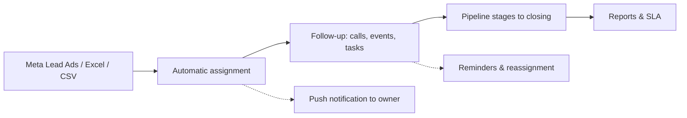

# Southeast Landmark CRM

A complete lead management and sales operations platform for a real estate developer. It captures every enquiry in one place, assigns it to the right salesperson at the right time, and tracks every call, visit, and follow-up through to closing — with the reporting managers need to see what is working.

Built for **Southeast Landmark Ltd.**, Dhaka, Bangladesh. Self-hosted, role-based, and designed for a phone-first sales team with a companion Android app.

> **Demo:** A guided demo with sample data is available on request. Please contact the maintainer. Live production access is not shared publicly.

## Highlights

- **No lead left behind** — Facebook Lead Ads arrive automatically, Excel/CSV files import with a preview and column mapping, and stale leads are escalated before they go cold.
- **Fair, schedule-aware assignment** — Leads go to owners who are actually on duty, with capacity limits and lowest-count / round-robin fallback.
- **One timeline per lead** — Contact details, form answers, calls, recordings, notes, events, and tasks in a single view.
- **Built for the field** — Lead Owners work from the Android app with push notifications for new assignments, reminders, and messages.
- **Manager-ready reporting** — Speed-to-lead, SLA compliance, pipeline, and team performance, restricted to management roles.
- **Secure by role** — Admins see everything. Lead Owners see only their own leads and clients. JWT authentication with optional TOTP multi-factor authentication.

## How a lead flows through the system



## Key capabilities

### Capture every enquiry

- **Meta Lead Ads integration** — Connect a Facebook Page from Settings with Facebook Login for Business. Lead forms sync automatically and new leads arrive via webhooks (with scheduled polling as a backup), including all custom form questions and answers.
- **Excel / CSV import** — Upload with a preview and manual column-mapping step, including native Meta export files, with duplicate detection and automatic assignment.
- **Contacts and clients** — A contact directory with source, district, and growth analytics derived from lead data.

### Distribute work fairly

- **Assignment engine** — Schedule-aware automatic assignment based on Lead Owners' duty windows (Asia/Dhaka), with lowest-count or round-robin fallback and per-owner capacity limits. Admins can assign or reassign manually at any time, individually or in bulk.
- **SLA protection** — Configurable response-time thresholds, reminders, manager alerts, and automatic reassignment of stale leads.

### Follow up and close

- **Lead pipeline** — Opportunities move through configurable pipeline stages with admin-defined temperature labels, priorities, and outcomes.
- **Complete lead profile** — Contact details, full activity timeline, call logs with optional recording upload, notes, tasks, and every answer the customer gave on the lead form.
- **Events and calendar** — Per-lead and standalone events with in-app reminders and notifications, on a colour-coded team calendar. Owner colours are managed centrally by the Admin.
- **Projects and inventory** — Projects, phases, blocks, roads, and plots, so sales conversations stay linked to real availability.
- **Tasks, messages, and tickets** — Internal messaging, team tasks, notifications, and support tickets keep coordination inside the CRM instead of scattered across chat apps.

### Measure what matters

- **Dashboards and reports** — Pipeline, response-time (speed-to-lead), SLA, and team performance views with Chart.js visualisations.
- **Role-restricted analytics** — Response-time and management reports are visible only to management roles.

## Mobile app and push notifications

A companion **Flutter Android app** gives Lead Owners full access from their phones: leads, clients, events, messages, tasks, and reports, with the same role-based visibility as the web app.

Push notifications (Firebase Cloud Messaging, HTTP v1 API) cover new lead assignments, reassignment, event reminders, and internal messages. Push is fail-safe by design: a push failure never blocks lead ingestion, assignment, or reminders.

## Security and access control

| Control | How it works |
| --- | --- |
| Role-based workspaces | Admin sees all leads and team performance; Lead Owners see only their own leads and clients |
| Authentication | JWT tokens (Flask-JWT-Extended) with configurable session timeout |
| Multi-factor authentication | Optional TOTP (with QR setup) |
| Password storage | bcrypt hashing |
| Account protection | Configurable login-attempt limits and lockout |
| API protection | Rate limiting (Flask-Limiter) and CORS controls |
| Time handling | Datetimes stored in UTC, presented in Asia/Dhaka throughout the UI |

Meta connection credentials (app credentials and Page token) are managed in the app under **Settings → Meta** and stored in the database. They do not belong in `.env`.

## Tech stack

| Layer | Technology |
| --- | --- |
| Backend | Python 3, Flask 3, SQLAlchemy 2, Flask-JWT-Extended, Flask-Migrate (Alembic) |
| Database | SQLite in production; any SQLAlchemy URL works (MySQL / PostgreSQL drivers available) |
| Frontend | Server-served HTML with vanilla JS, FullCalendar, Chart.js |
| Scheduling | APScheduler (in-process; scheduler can also run via `cron.py`) |
| Push | Firebase Cloud Messaging, HTTP v1 API |
| Email | Flask-Mail (SMTP) |
| Serving | Gunicorn behind nginx, managed by systemd |
| Mobile | Flutter Android app (companion project, REST API) |

## Project structure

```
backend/
  app/              Flask application
    blueprints/     Feature modules: leads, dashboard, events, projects,
                    contacts, prospects, finance, expenses, tasks, messages,
                    notifications, reports, team, users, settings, security,
                    tickets, help, auth, webhooks
    static/         Web UI (HTML / CSS / JS)
    models.py       SQLAlchemy models (leads, projects, plots, users, tasks, ...)
    push.py         FCM push sender (fail-safe)
    tasks.py        Background tasks (polling, reminders, SLA)
  migrations/       Alembic migrations
  mega/             Vendored MEGA client for call-recording storage
  wsgi.py           Production WSGI entry point
  run.py            Development entry point
  cron.py           Scheduler entry point (used when DISABLE_SCHEDULER=True)
  test_*.py         Test suites
frontend/           Earlier standalone UI prototype (not served; kept for reference)
requirements.txt    Python dependencies
.env.example        Configuration template
```

## Getting started (development)

```bash
git clone https://github.com/pythonicshariful/Real-Estate-CRM.git
cd Real-Estate-CRM
python -m venv venv && source venv/bin/activate
pip install -r requirements.txt
cp .env.example backend/.env   # then fill in the values
cd backend && python run.py
```

With the development configuration the app creates a local SQLite database on first run.

## Configuration

Copy `.env.example` to `backend/.env` and set at least:

| Variable | Purpose |
| --- | --- |
| `SECRET_KEY` | Flask session secret |
| `JWT_SECRET_KEY` | Token signing secret |
| `DATABASE_URL` | SQLAlchemy connection string |
| `MAIL_*` | SMTP settings for outgoing mail |
| `MEGA_*` | MEGA account used for call-recording storage |
| `META_*` | Meta app / Page settings (see Settings → Meta in the app) |
| `SLA_*` | SLA reminder, alert, and escalation intervals |
| `DISABLE_SCHEDULER` | Set `True` when the scheduler runs via `cron.py` |

Never commit a filled-in `.env` file. Use strong, unique values for `SECRET_KEY` and `JWT_SECRET_KEY` in production.

## Testing

Each feature area has a `test_*.py` suite in `backend/`; run them with the project's virtual environment, for example:

```bash
cd backend
python test_event_reminders.py
python smoke_test.py   # end-to-end API smoke suite
```

## Deployment

Production runs on a Linux VPS: Gunicorn serves `backend/wsgi.py`, nginx terminates TLS and reverse-proxies to it, and a systemd unit keeps the service running. Updates are deployed by pulling the `main` branch and restarting the service.

## License

Proprietary software — © Southeast Landmark Ltd. All rights reserved.

Developed and maintained by [Shariful Islam](https://github.com/pythonicshariful).
